# Bootstrap-environment

**Run a software project with a team of AI assistants, and stay in control.**

You talk to one assistant, the **Chief of Staff**. It runs a small team of AI sessions, each with one job:
Builder, QA, Design, Librarian and Researcher from the start, and Security, Tech Lead, Release Ops and others
when a change needs them. Every session reports to the Chief of Staff, so you never jump between chats or
click "allow" in each one. Every change is checked by the right team
members, nothing visual or risky lands without **your approval**, and nothing goes live without **your word**.
These rules are enforced by the tools, not left to the assistants' good behaviour.

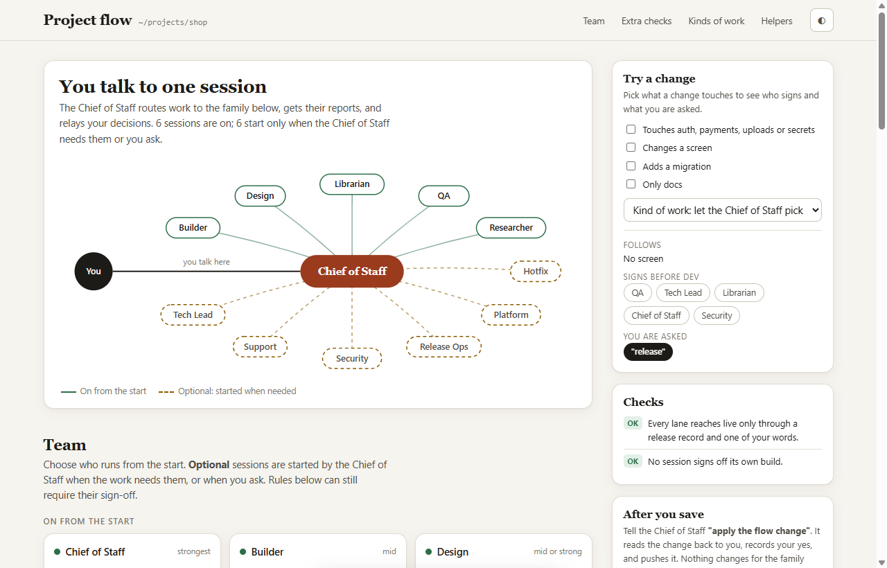

> **Status: 0.6.0, early.** 74 tests pass against real git repositories. Claude Code is fully supported;
> adapters for 13 other AI tools follow their November 2026 docs and still need testing inside each tool
> (see [TODO.md](TODO.md)).

---

## Contents

[Why this exists](#why-this-exists) · [Who it is for](#who-it-is-for) · [Use cases](#use-cases) ·
[Advantages](#advantages) · [How it works](#how-it-works) · [Screenshots](#screenshots) ·
[Quick start](#quick-start) · [Who checks what](#who-checks-what) · [The team](#the-team) ·
[Light on tokens](#light-on-tokens) · [Commands](#commands) · [Other AI tools](#other-ai-tools) ·
[FAQ](#faq) · [Limits](#honest-limits)

---

## Why this exists

A single AI assistant is fast, but it fails in predictable ways. Adding more assistants makes it worse unless
someone is in charge. This plugin turns each known failure into a rule the tools enforce:

| What goes wrong with AI assistants | What this plugin does |
|---|---|
| It says "done" or "fixed" when it isn't | A sign-off only counts with **evidence** (a command and its output, or file:line) |
| It skips steps when in a hurry: no tests, no design check | Code is **refused** until every required check is signed on that exact version |
| A vague "yes" gets stretched into permission to go live | Your word is recorded **with the exact question you answered**; nothing goes live without it |
| It reviews its own work | **Separation of duties**: a session can sign only as itself, and the builder never approves its own code |
| It forgets what was learned last week | **Memory in the repo**: one file per lesson, searchable with `mem find` |
| It works on the wrong branch, database or files | Each session has its **own worktree and limits**; a guard blocks what its role must never do |
| Several assistants talk past each other | **One coordinator**, one board, short messages that point to files |
| It costs a fortune in tokens | Each session reads **only its own rules** (~2k tokens instead of ~7k) and asks the tools instead of reading files |

## Who it is for

| Good fit | Probably not needed |
|---|---|
| A **founder or business owner** running a live product with real users, money or staff data, who wants AI to do most of the work | A weekend prototype: use `--size prototype` (Solo preset) or skip it |
| A **small team** adopting AI agents that wants reviews, approvals and an audit trail without hiring a process manager | A large team that already has code review, CI and release management (take the memory and role briefs only) |
| An **agency** running several client projects that needs the same rules everywhere (company defaults) | Someone who wants the AI to work completely unsupervised |
| A **non-programmer** who needs plain-language control over what ships | |

## Use cases

**1. A solo founder with a live app.** You ask the Chief of Staff for "an invoice footer with our bank
details". It routes the piece to the *Normal* lane. Research and Design prepare an artifact, and you approve it
in one message. QA writes the checks, the Builder builds it, QA and the Librarian sign off with evidence, and you
tell the Chief of Staff `release invoice-footer`. You never read code, but every step is on record.

**2. A risky change.** "Rate-limit password resets" touches login code, so `bootstrap piece R15 --suggest`
proposes the *HIGH* lane. Security must sign too, a threat note is written, and nothing is built until you
say **go**. If someone forgets, the push is refused with the reason: `owner's word go: no _go.md record`.

**3. Something is broken in production.** The *Hotfix* lane skips the long route: reproduce, fix, a short QA
check, then your word `apply`. It's still recorded, still evidenced, just faster.

**4. An agency with ten client projects.** You write company defaults once: "Tech Lead signs every code push",
"Security signs HIGH work", "never install `random-dev/unsafe-hooks`". Every project inherits them. A project
can add checks but can't remove a 🔒 locked one, and the editor shows an error if it tries.

**5. A prototype.** `bootstrap init --size prototype` starts with the *Solo* preset: one agent plays the roles
in turn, and the push checks still keep a minimum of discipline.

## Advantages

- **Control without micromanaging.** You decide only what matters: approve designs, say "go" on risky work, release. Everything else runs on its own.
- **Proof, not promises.** Every approval carries evidence and the exact commit it covers, so "done" means done.
- **Enforced, not hoped for.** A git pre-push check that runs in every tool refuses work that skipped a step, and explains what's missing.
- **Your process, your way.** One page to switch sessions on or make them optional, say which files bring in Security or Design, pick who signs each kind of work, and set how many helper agents a session may use. Or just tell the Chief of Staff what to change.
- **Fits your branches.** It finds your live branch (`main`, `master`, `trunk`…) and uses a dev branch only if you have one.
- **See before you commit.** "Try a change" shows the path a change would take, who must approve it, and whether a push would get through. It uses the same logic as the real pre-push check.
- **Same rules everywhere.** Company defaults with locked minimums, approved sources and blocked sources.
- **Remembers.** Lessons, decisions and hand-overs live in the repository, not in a chat that disappears.
- **Light on tokens.** Each session reads only its own rules and asks short commands instead of reading big files.
- **Works beyond Claude.** One source generates files for Cursor, Codex, Copilot, Antigravity, Devin, Kiro, OpenCode, Cline and more.
- **Free and open.** MIT licence, no dependencies, no paid services. Free plugins only, by design.

---

## How it works

### The big picture

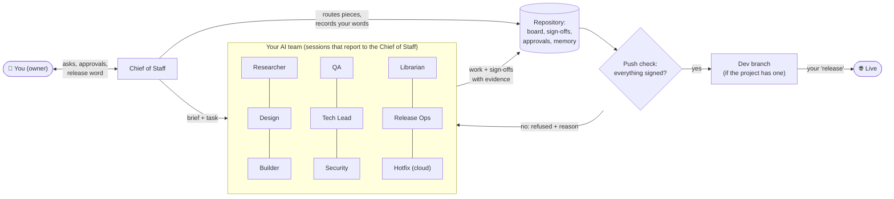

### Setting up a project (once)

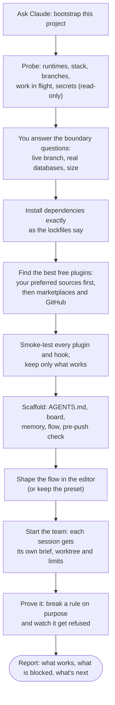

### The life of one piece of work

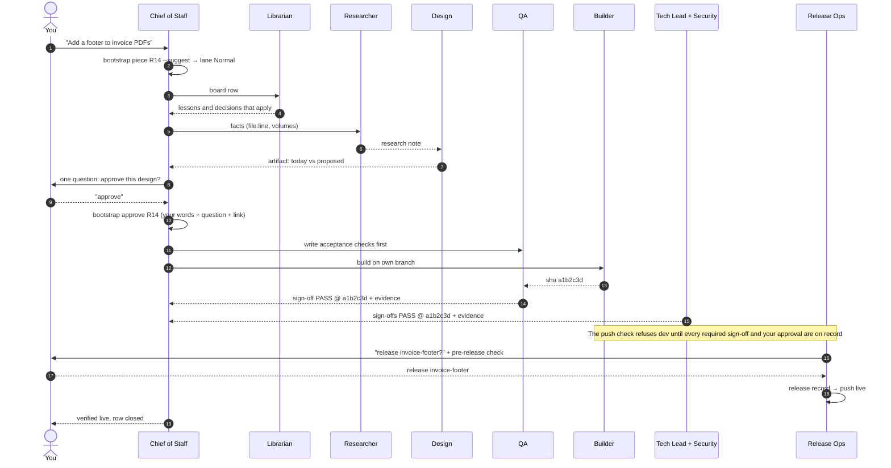

### Will my push be accepted?

This is exactly what the pre-push check decides, in every tool and for every person:

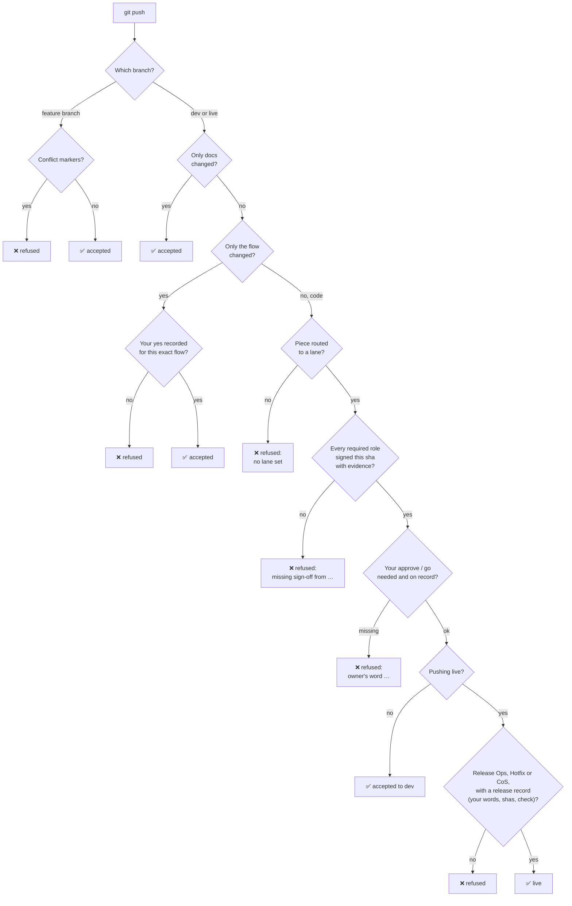

### The four lanes (you can add your own)

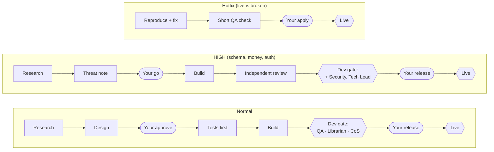

With no dev branch, the dev gate goes away and the same sign-offs are checked when the release reaches
live. The *No screen* lane is Normal without the design steps. File conditions add checks in **every** lane:
login, payment or upload files add **Security**; screen files add **Design** and **your approval**;
migrations add **Tech Lead**.

### Four layers of protection

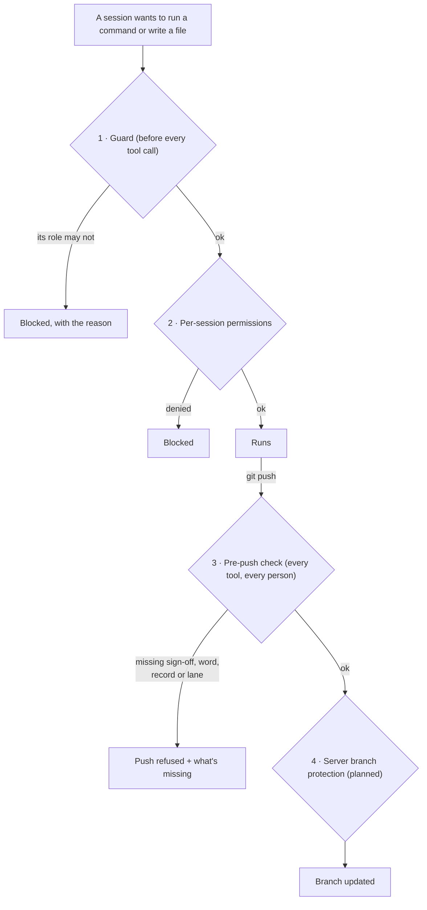

---

## Screenshots

Ask the Chief of Staff to "open the flow editor" (or type `/flow`). It opens on this computer only, in the
app's browser pane or your browser. You change what you want and press **Save**; the Chief of Staff reads
the change back to you in plain words and, on your yes, records it and pushes it. Nothing changes for the
team until then. Everything here can also be said in chat instead.

### You talk to one session


Solid lines are sessions **on from the start**; dashed ones are **optional**, started by the Chief of Staff
when a piece needs them or when you ask. Click one to jump to it. On the right, **Try a change** shows who
signs and what you are asked for a pretend change, using the same code as the push check.

### Team

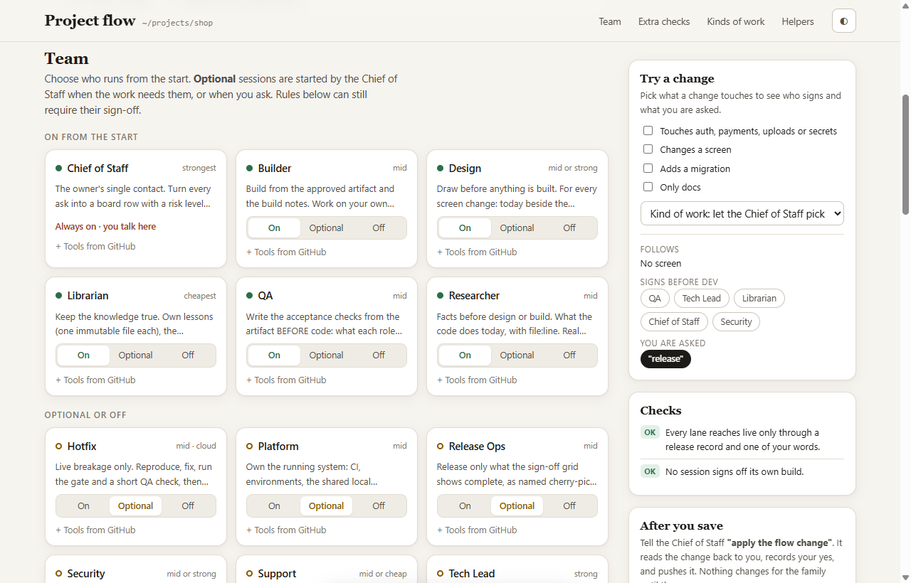

One switch per session: **On**, **Optional** or **Off**. The Chief of Staff is always on. Each card can
also list GitHub sources you prefer for that session's tools.

### Extra checks

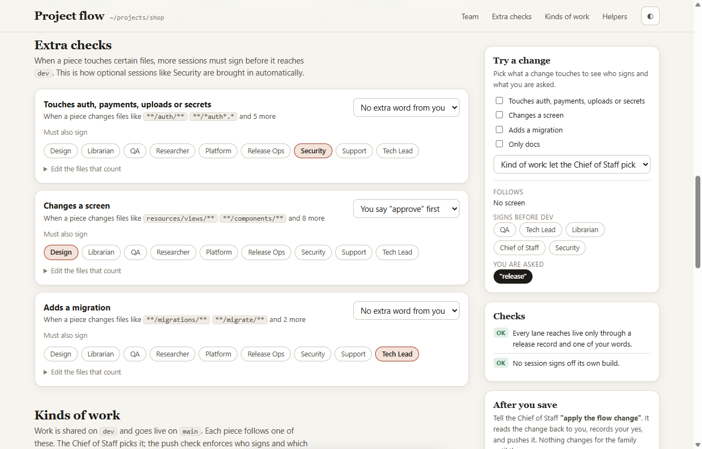

When a piece touches certain files, more sessions must sign. This is how an optional session like
Security joins automatically for login, payment, upload or secret files, so "optional" never means
"forgotten". Edit the file patterns, who signs, and whether you must say a word like "approve" first.

### Kinds of work

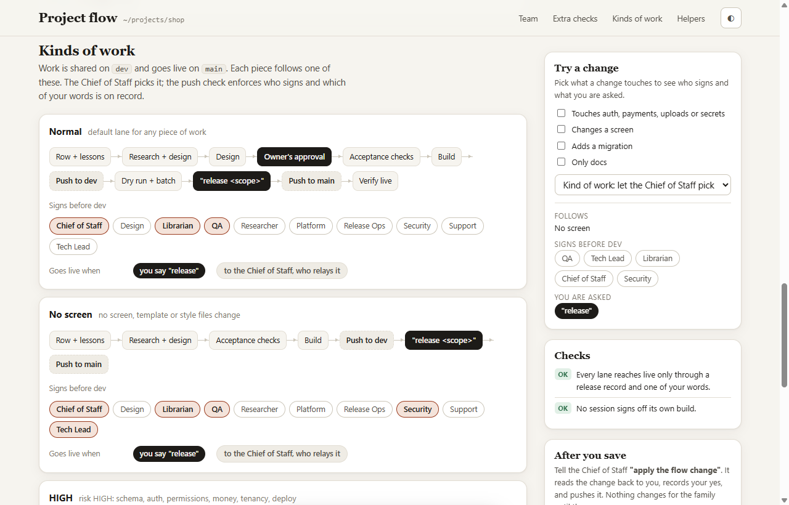

Each lane's steps, named after your real branches, who signs before the shared branch, and which of your
words takes it live. Below it, **Helpers** sets how many helper agents one session may start (2 by
default) and which model they must use (the cheapest).

<p align="center">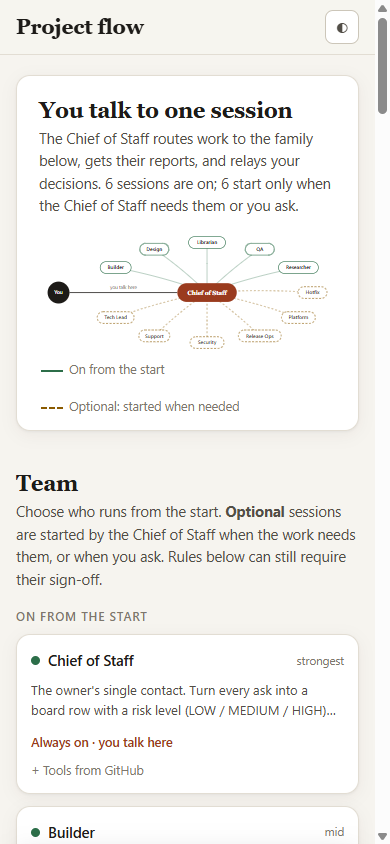<br><em>Works on a phone too.</em></p>

### What a session sees in the terminal

```text
$ bootstrap next R14
R14 · Invoice PDF footer
  lane: normal · files changed: 2
  ✓ Design @ a1b2c3d4e
  ✓ QA @ a1b2c3d4e
  ✗ Tech Lead: not signed
  ✗ Librarian: not signed
  ✗ Chief of Staff: not signed
  ✗ owner's "approve": no _approve.md record
  NEXT: Chief of Staff asks the owner for "approve" and records it (`bootstrap approve R14 --word approve …`)

$ bootstrap piece R15 --suggest
R15: suggested lane "high" (touches auth, payments, uploads or secrets)
  sign-offs: Chief of Staff, Librarian, QA, Security, Tech Lead
  owner's words: go
```

---

## Quick start

**Claude Code** (full support):

```bash
claude plugin marketplace add AnfalHaider/Bootstrap-environment
```

```bash
claude plugin install bootstrap-environment@bootstrap-environment --scope project
```

Then say: *"bootstrap this project"*. The skill asks a few questions (the project's size, which branch is
live, which databases are real) and does the rest.

**Any tool with a shell:**

```bash
git clone https://github.com/AnfalHaider/Bootstrap-environment ~/bootstrap-environment
```

```bash
node ~/bootstrap-environment/bin/bootstrap.mjs init --size live
```

```bash
node .bootstrap/bin/bootstrap.mjs flow --open
```

```bash
node .bootstrap/bin/adapt.mjs cursor
```

`--size` is `prototype`, `small` or `live`. Branches are detected: the live branch is the remote's default (`main`, `master`, `trunk`…), and a dev branch is used only if one exists. Override with `--live <branch> --dev <branch>|none`. Replace `cursor` with your tool; `adapt.mjs list` shows them all.

## Who checks what

| When… | Who must approve, on that exact version | Enforced by |
|---|---|---|
| Any code joins the dev branch (or live, when there is no dev branch) | the lane's sessions (Normal: QA, Librarian, Chief of Staff) | pre-push check |
| The code touches login, payments, uploads or secrets | + Security | pre-push check |
| The code adds a migration | + Tech Lead | pre-push check |
| The code changes a screen | + Design, **and your recorded approval of the design** | pre-push check |
| The work is HIGH risk (schema, money, permissions…) | + Security, **and your recorded "go"** | pre-push check |
| Any sign-off | must carry **evidence**; a bare PASS is ignored | pre-push check |
| Code isn't routed to a lane yet | refused: the Chief of Staff routes every piece | pre-push check |
| Anything goes live | Release Ops, Hotfix or the Chief of Staff, **your "release"/"apply"** with the question answered, shas and a pasted check | pre-push check |
| The flow itself changes | **your recorded yes** for that exact flow (`bootstrap flow apply`); a later edit needs a new yes | pre-push check |
| The kit is upgraded | **your recorded yes** for those exact kit files (`bootstrap kit apply`), pushed on their own; kit files mixed with project code need the full flow | pre-push check |
| A session starts a helper agent | at most 2 per session, on the cheapest model | guard |

**Who may write each record:**
- A session can sign **only as itself**.
- Only the Chief of Staff can route a piece or record your approval, "go" or yes to a flow change.
- Only Release Ops, Hotfix or the Chief of Staff can write a release record.

**Not checked by the tools:** conversations, plans and research (nothing is pushed), commands run outside git, and docs-only commits (deliberately free).

## The team

| Session | Job | Never |
|---|---|---|
| **Chief of Staff** | your single contact: routes work, records your words, checks scope, sends a daily digest | pushes live, decides for you |
| **Librarian** | lessons, decisions, board and register hygiene | writes code |
| **Researcher** | facts with file:line, real volumes, options | writes app code, touches real data |
| **Design** | today-vs-proposed artifacts; signs built screens | writes code |
| **Builder** | builds on its own branch with proof | pushes before sign-offs, reviews itself |
| **QA** | acceptance checks before code; tests on a copy | fixes app code |
| **Tech Lead** | architecture decisions, code and schema review, upgrades | reviews its own code |
| **Security** | sensitive changes, dependency audits, plugin safety checks | signs its own fixes |
| **Release Ops** | dry run, release batches, pushes live on your word | hotfixes |
| **Hotfix** | live breakage only, in the cloud, on your "apply" | features |
| **Platform** *(on demand)* | CI, environments, backups, monitoring | runs server commands itself |
| **Support** *(on demand)* | user reports to rows, release notes | promises users dates |
| **Project lanes** | one area each (e.g. onboarding, billing) | another lane's files |

**On from the start:** Chief of Staff, Builder, QA, Design, Librarian, Researcher. **Optional:** Security,
Tech Lead, Release Ops, Hotfix, Platform, Support. The Chief of Staff starts an optional session when a piece
needs its sign-off (`bootstrap next` names it) or when you ask, and `bootstrap family` lists both groups.
Change either list in the editor or by asking the Chief of Staff.

Every session is a linked session of the Chief of Staff and reports to it. Your decisions reach a session
as a **record**: the Chief of Staff writes your exact words and the question you answered, commits them,
and points the session to the record. A message alone is never taken as your word. Sessions push without
a permission click, because the pre-push check is the real gate. Each session's first message is its role
file plus `bootstrap brief <role>`: only its own rules, in full with their reasons.

## Light on tokens

The sessions are permanent, so what each one reads is paid again and again. The figures below were measured on a fresh project:

| | Before (0.3) | Now (0.4) |
|---|---|---|
| Loaded in every session | ~1,350 tokens | ~1,050 tokens |
| A session's start (its rules + its part in the flow) | ~5,800 tokens | ~700–1,300 tokens |
| **Total to start one session** | **~7,000** | **~2,000 (about 70% less)** |
| Guard check per command | ~220 ms | ~115 ms |

How it stays light:
- **One brief per role**, built from `flow/rules.json`, where every rule lives once.
- **Ask the tools, not the files:** `next`, `board --mine`, `mem find`.
- **Short messages that point to files**, never pasted content.
- **`board archive`** keeps the board small.
- **`cost`** warns when something grows too big.

## Commands

| Command | What it does | Who |
|---|---|---|
| `bootstrap init --size …` | set up a project (never overwrites; branches detected) | owner / Claude |
| `/flow` or `bootstrap flow --open` | the flow editor: team, extra checks, kinds of work, helpers, change simulator | owner, via the Chief of Staff |
| `bootstrap flow apply --words … --question …` | record your yes to a flow change | Chief of Staff |
| `/upgrade` or `bootstrap upgrade`, then `bootstrap kit apply …` | refresh the kit from a newer plugin; record your yes to it | Chief of Staff |
| `bootstrap family` | which sessions are on, which are optional; branches; helper limit | Chief of Staff |
| `bootstrap brief <role>` | that role's rules and its part in the flow | Chief of Staff, at session start |
| `bootstrap role <role>` | mark a worktree's session and apply its limits | each session, once |
| `bootstrap piece <id> --suggest` / `--lane <lane>` | suggest / set a piece's lane | Chief of Staff |
| `bootstrap approve <id> --word approve\|go …` | record your approval or go, with your exact words | Chief of Staff |
| `bootstrap signoff <id> --verdict PASS --note "<evidence>"` | sign as yourself, with evidence | reviewers |
| `bootstrap next <id>` | what's missing and who acts next | anyone |
| `bootstrap board --mine` / `board archive` | your rows only / move old done rows out | anyone / Librarian |
| `bootstrap release <scope> …` | release record before going live | Release Ops, Hotfix, Chief of Staff |
| `bootstrap cost` · `flow check` · `status` | token cost per session · flow problems · current state | anyone |
| `bootstrap company init <dir>` / `flow --company <dir>` | create / edit company defaults | owner |
| `mem find <topic>` · `mem check` | lessons that match · stale-memory check | anyone |
| `detect-stack` · `adapt <tool>` | stack profile and install commands · files for another AI tool | Claude / owner |

## Other AI tools

| Tool | Skill | Team | Guard | Pre-push | Notes |
|---|---|---|---|---|---|
| Claude Code | ✅ | linked sessions under the Chief of Staff | ✅ | ✅ | full support |
| Cursor | ✅ | `.cursor/agents` | manual | ✅ | subagents only have `readonly` |
| Codex | ✅ | separate launches | `.codex/rules` | ✅ | no LSP; AGENTS.md ≤ 32 KiB |
| GitHub Copilot | ✅ | `.github/agents` | manual | ✅ | cloud agent: MCP tools only |
| Antigravity CLI | ✅ | `.agents/agents` | manual | ✅ | replaces Gemini CLI for free users |
| Devin Desktop | ✅ | — | project hook | ✅ | formerly Windsurf |
| Kiro · OpenCode | ✅ | agents | manual | ✅ | per-agent permissions |
| Cline · Aider · Zed · Junie · Amp | partial | one agent plays the roles | — | ✅ | AGENTS.md + git hooks |
| ChatGPT | upload | advisor only | — | — | no filesystem; real work goes to Codex |

The pre-push check works everywhere, because git runs it. Details and sources: [docs/compatibility.md](docs/compatibility.md).

## FAQ

**Do I need to know how to code?** No. You answer questions in plain words, approve designs, and type
`release`. The editor explains every term, and the Chief of Staff asks one question at a time.

**Is it slow or heavy?** A session start costs about 2,000 tokens, and the guard adds about 0.1 seconds per
command. For small projects, `--size prototype` or `small` uses a lighter flow.

**Can I relax the rules?** Yes. Make a session optional, untick a reviewer, or tell the Chief of Staff what to
change. The Checks panel warns you when a change leaves code unreviewed, and every flow change needs your
recorded yes. Only company 🔒 minimums can't be loosened.

**My project has no dev branch, or uses `master`.** That's fine. The live branch is detected, and without a
dev branch, pieces go to live through a release with the same sign-offs checked there.

**How do I upgrade the kit in a project that already has it?** Update the plugin, then type `/upgrade` to the
Chief of Staff. It refreshes the kit's own files (your policy, flow and records stay), tells you what changes,
and on your yes records it and pushes. A kit change without your yes, or edited after it, is refused.

**Do I have to approve pushes in every session?** No. Sessions push without a permission click; the pre-push
check refuses anything without its sign-offs or your recorded word. You only answer the Chief of Staff.

**What if a session ignores the rules?** Then its push is refused, with the reason. The rules that matter are
checked by tools, not trusted to the assistant.

**Does it cost money?** No. MIT licence, no dependencies, and it installs only free plugins.

**What about my data?** Everything stays in your repository and on your machine. The editor runs on
127.0.0.1 with a one-time token. Nothing is sent anywhere.

## Honest limits

- All sessions on one machine share one git identity. Someone working **outside** the AI tools could still edit sign-off files by hand. A separate identity per role, plus server-side checks, is the next step ([TODO](TODO.md)).
- Layers 1–3 run on your computer; only server-side branch protection also binds cloud agents. Turn it on for your live and dev branches.
- Adapters for other tools follow vendor docs and still need testing inside each tool.

## Repository layout

```text
skills/bootstrap-environment/   the skill (Agent Skills format) + references opened per phase
bin/                            bootstrap, guard, prepush, mem, detect-stack, adapt, flow-ui (Node ≥18, no deps)
flow/defaults.json · rules.json built-in lanes, gates, conditions, words · every rule with its reason
ui/flow-editor.html             the flow editor
commands/                       the /flow and /upgrade commands
roles/                          one brief per session
templates/                      AGENTS.md, board, register, memory, lesson
githooks/pre-push · hooks/      the push check · the Claude Code guard hook
docs/                           compatibility matrix, playbook, screenshots
tests/                          npm test (74 tests)
```

## Contributing

Issues and pull requests are welcome, especially adapter fixes from people who use those tools daily.
Run `npm test` first; new enforcement needs a test for every branch.

## Licence

[MIT](LICENSE)
