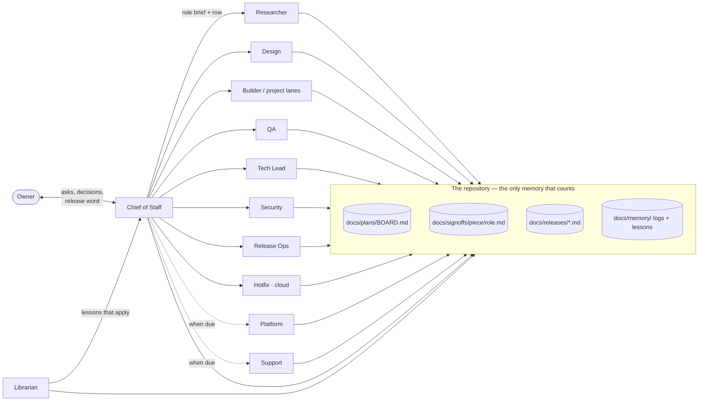
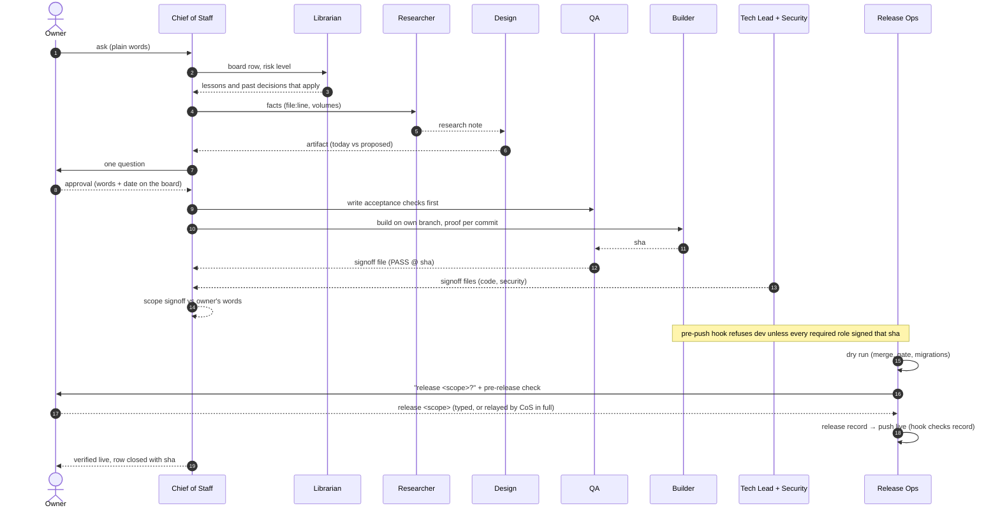
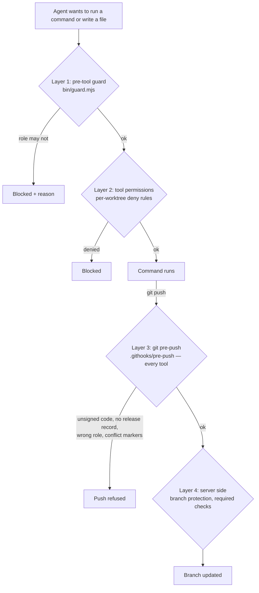

# Bootstrap-environment

**Set up any software project for AI coding agents, then run it like a small IT company.** One
coordinating session (the Chief of Staff) runs named role sessions — Librarian, Researcher, Design,
Builder, QA, Tech Lead, Security, Release Ops, Hotfix, plus on-demand Platform and Support — and their
limits are **enforced by tooling**, not just written down.

It ships as an [Agent Skill](https://agentskills.io) plus a dependency-free Node toolkit, packaged as a
Claude Code plugin, with adapters for Cursor, Codex, GitHub Copilot, Antigravity, Devin Desktop, Kiro,
OpenCode, Cline, Aider, Zed, Junie, Amp and ChatGPT.

> Status: **0.4.0, early.** The enforcement scripts, the flow editor and the token-saving commands have a test suite (58 tests, real temporary git repos). The per-tool adapters follow vendor docs as of November 2026 and are not yet tested inside each tool — see [TODO.md](TODO.md).

## What it does

1. **Bootstrap (once per project).** Probe runtimes by running them; detect the stack from lockfiles;
   install dependencies exactly as locked; search the official marketplace, the marketplaces you have and
   GitHub for the best free plugin per need (language server, framework, browser driver, security);
   smoke-test every one; scaffold `AGENTS.md`, a board, a pending register, sign-off and release records
   and a conflict-free memory.
2. **Session family (every day).** The owner talks to one session. Work moves through a fixed lane with
   sign-offs. Nothing reaches the shared branch until the right roles have signed the exact commit, and
   nothing reaches live without the owner's word recorded with its question, scope and a pasted check.

## In plain words

You talk to **one** assistant, the Chief of Staff. Behind it is a small team of assistants, each with one job:
Design draws screens, Builder writes code, QA tests, Tech Lead reviews code, Security checks the risky parts,
Release Ops puts finished work live. Before code can join the shared work, **the right team members must
approve that exact version**. A screen change also needs **your** approval of the design, and nothing goes live
without your word. These checks are run by the tools, not left to the assistants' good behaviour: if one is
missing, the code is refused and the assistant is told exactly what is missing.

New to this? Open the visual editor (below). Every term on it has a plain-language explanation one click away.

## Who checks what (and what is not checked)

| When… | Who must approve, on that exact version | Enforced by |
|---|---|---|
| Any code joins the dev branch | the sessions its lane requires (Normal: QA, Tech Lead, Librarian, Chief of Staff) | pre-push hook |
| The code touches login, payments, uploads, secrets | + Security | pre-push hook (file conditions) |
| The code changes a screen | + Design, **and your recorded approval of the design** (with a link to it) | pre-push hook |
| Any sign-off | must carry **evidence** (a command and its output, or file:line); a bare PASS is ignored | pre-push hook |
| The work is HIGH risk (schema, money, permissions…) | + Security, **and your recorded "go"** before it can land | pre-push hook |
| Anything goes live | Release Ops (or Hotfix), **your "release"/"apply"** with the question you answered, the shas and a pasted check | pre-push hook |
| Code is not on a lane yet | refused: the Chief of Staff must route every piece (`bootstrap piece R12 --lane normal`) | pre-push hook |

Who may write each record:
- A session can sign **only as itself**.
- Only the Chief of Staff can route a piece or record your approval or "go".
- Only Release Ops, Hotfix or the Chief of Staff can write a release record.

The guard blocks other sessions from writing these, by file or by command, and the `bootstrap` command refuses too.

**Not checked by the tools:** conversations, plans and research (nothing is pushed), commands run outside git, and docs-only commits (deliberately free).

**Honest limit:** all sessions on one machine share one git identity. A determined person can still edit files outside the AI tools. Server-side checks with a separate identity per role are on the [TODO](TODO.md).

## Light on tokens

The sessions are permanent (nested under the Chief of Staff wherever the tool supports it), so what each one *reads* is paid again and again. Measured on a fresh project:

| | Before (0.3) | Now (0.4) |
|---|---|---|
| Loaded in every session (AGENTS.md + CLAUDE.md) | ~1,350 tokens | ~1,050 tokens |
| A session's start (its rules + its part in the flow) | ~5,800 tokens (whole rulebook) | ~700–1,300 tokens (`bootstrap brief <role>`) |
| **Total to start one session** | **~7,000** | **~2,000 (about 70% less)** |
| Guard hook per command | ~220 ms | ~115 ms |

How:
- **One brief per role.** `bootstrap brief qa` gives QA every rule that applies to QA, in full with its reason, and none of the release rules it never uses. The rules live once, in `flow/rules.json`.
- **Ask the tools, not the files:**
  - `bootstrap next R14`: what's still missing, and who acts next.
  - `bootstrap board --mine`: only your rows.
  - `mem find <topic>`: only the lessons that match.
- **Short messages that point to files** ("see docs/research/R14.md @ abc123"), never pasted content.
- **The board stays small.** `bootstrap board archive` moves old DONE rows out. `bootstrap cost` shows each session's start cost and warns when something grows.
- **Right-sized from day one.** `bootstrap init --size prototype|small|live` picks Solo, Small team or Full company.

## How information flows



Chat is a copy; the repository is the record. Every session writes its own log and its own sign-off
files (one writer per file, so no merge conflicts), and the Chief of Staff relays nothing that is not
written down.

## How a piece of work moves



## Define your own flow — visual editor

Every team works differently, so the flow is **data the tooling obeys**, not code: lanes, stages, gates,
conditions, your words and the sessions themselves live in `.bootstrap/flow.json`. Edit it visually:

```bash
node .bootstrap/bin/bootstrap.mjs flow --open
```

A local page opens (127.0.0.1 only, with a one-time access token). It's written for beginners: a welcome card walks you through the three steps, every tab starts with a short "what is this" and an example, every field has a hint, and every term (lane, gate, sign-off, relay…) opens a plain-language **Help** panel. On it you can:

- **Flow:** draw lanes (Normal, No screen, HIGH, Hotfix, or your own) as stages owned by sessions, plus the gates and the points where your word is needed. Add, remove and reorder them.
- **Sessions:** edit each session's name, job, limits, model class, skills and plugins, add your own sessions (for example "Data Engineer"), and **paste GitHub links** to the plugins and skills you prefer for each one. They're searched first during plugin discovery, pinned to a commit, and trust-checked unless they're official.
- **Gates & words:** choose which sessions must sign before code reaches dev in each lane; set conditions such as "touches auth → Security must sign"; decide whether each of your words may be relayed.
- **Check:** problems are found as you edit, by the same code the pre-push hook runs, labelled *Must fix*, *Worth fixing* or *Good to know*, each with a **Go to** button. Save stays off while anything must be fixed.
- **Your approval:** per lane ("your word before building": approve or go) and per file condition ("you must approve the design first").
- **Board:** each piece's lane and its missing sign-offs. **Presets:** Full company, Small team, Solo, Custom.

Saving writes `.bootstrap/flow.json` and a readable `docs/flow.md` with a diagram for each lane. **What you draw is what's enforced:** the pre-push hook works out each piece's required sign-offs from its lane (`bootstrap piece R12 --lane high`) plus the conditions its files match. It judges a push by the flow **already on the remote**, so a commit can't loosen the rules to get itself through.

### Company defaults

Set rules once for every project. Create a company defaults folder (usually its own repo) and edit it with the same page:

```bash
node .bootstrap/bin/bootstrap.mjs company init ../agent-defaults --name "Acme"
```

```bash
node .bootstrap/bin/bootstrap.mjs flow --company ../agent-defaults --open
```

A project inherits it by setting **Defaults live in** to `github:acme/agent-defaults@<sha>` (a reviewed copy is kept in `.bootstrap/company.json`) or a local path. Company settings are of two kinds:

- **Defaults:** a project may change them (preset, lanes, approved sources).
- **🔒 Locked floors:** a project may tighten them but never loosen them. Examples: "Tech Lead signs every code push", "Security signs HIGH work", "no relays of apply". The company can also list **blocked sources**, which are never installed even when someone pastes them.

The editor's **Check for updates** button picks up new company versions.

## How the rules are enforced (defence in depth)



| Layer | Where | Catches | Works in |
|---|---|---|---|
| 1 Guard | pre-tool hook | force-push, `--no-verify`, hook tampering, server commands, live push by the wrong role, docs-only roles writing code, protected config, **signing as another session, routing or recording your words unless Chief of Staff, role spoofing** | Claude Code (plugin or project hook); other tools where hooks exist — see adapters |
| 2 Permissions | `.claude/settings.local.json` per worktree (`bootstrap role`) | the role's `deny` list; plugin kit narrowing | Claude Code; partial elsewhere |
| 3 Pre-push | `git config core.hooksPath .githooks` | code not routed to a lane; code commits without complete sign-offs on that sha; screen changes without your recorded approval; HIGH work without your recorded "go"; live pushes without a release record (owner's words, question, shas, pasted check); deleting live/dev; conflict markers | **every tool and every human** |
| 4 Server | GitHub branch protection / required checks | anything pushed from a machine without the hooks, including cloud agents | GitHub (configure it — see TODO) |

Layers 1–3 run on the developer's machine and can be bypassed by someone determined to; layer 4 cannot.
Turn it on for the live and dev branches.

## The roles

| Role id | Job | Never | Class |
|---|---|---|---|
| `chief-of-staff` | owner's single contact; rows, risk, briefs, scope sign-off, relays, daily digest | push live, decide for the owner | core · strongest model |
| `librarian` | lessons, decisions trail, board and register hygiene | code, decisions | core · cheapest |
| `researcher` | facts with file:line, volumes, options | app code, real-DB writes | core |
| `design` | artifacts today-vs-proposed; signs built screens | code | core |
| `builder` | builds on its own branch with proof | push before sign-offs, touch live | core |
| `qa` | acceptance checks before code; tests on a copy | fix app code | core |
| `tech-lead` | ADRs, code and schema review, dependency upgrades | review its own code | core · strong |
| `security` | reviews sensitive surfaces, audits, plugin trust checks | sign its own fixes | core |
| `release-ops` | dry run, batches, push live on the recorded word | hotfixes, relayed peer words | core |
| `hotfix` | live breakage only, cloud, pushes on "apply" | features, running locally | core · cloud |
| `platform` | CI, environments, DB server, backups, monitoring | run server commands itself | on demand |
| `support` | user reports → rows, release notes | promise users dates | on demand |
| `project-lane` | one cross-cutting area (template) | another lane's files | per project |

Each role's brief — job, never, kit, first message — is a file in [`roles/`](roles). The Chief of Staff
sends it unchanged; the guard and adapters read the same file.

## Install

**Claude Code** (full support):

```bash
claude plugin marketplace add AnfalHaider/Bootstrap-environment
```

```bash
claude plugin install bootstrap-environment@bootstrap-environment --scope project
```

Then ask: *"bootstrap this project"*. The skill runs the phases and calls the toolkit.

**Any tool with a shell** (clone once, run inside your project):

```bash
git clone https://github.com/AnfalHaider/Bootstrap-environment ~/bootstrap-environment
```

```bash
node ~/bootstrap-environment/bin/detect-stack.mjs
```

```bash
node ~/bootstrap-environment/bin/bootstrap.mjs init --live main --dev dev
```

```bash
node .bootstrap/bin/adapt.mjs cursor
```

Replace `cursor` with your tool: `node .bootstrap/bin/adapt.mjs list` shows them all and what each gets.

## Tool support at a glance

| Tool | Skill | Role agents | Guard hook | Pre-push | Notes |
|---|---|---|---|---|---|
| Claude Code | yes | session family | yes | yes | baseline; plugin + marketplace in this repo |
| Cursor | yes | `.cursor/agents` | manual wiring | yes | subagents only have `readonly` |
| Codex | yes | separate launches | `.codex/rules` | yes | no LSP; AGENTS.md ≤ 32 KiB |
| GitHub Copilot | yes | `.github/agents` | manual wiring | yes | cloud agent: MCP tools only |
| Antigravity CLI | yes | `.agents/agents` | manual wiring | yes | replaces Gemini CLI for free users |
| Devin Desktop | yes | — | project hook | yes | ex-Windsurf; installs the Claude plugin |
| Kiro | yes | `.kiro/agents` | manual wiring | yes | steering file always included |
| OpenCode | yes | `opencode.json` agents | — | yes | per-agent permissions |
| Cline | yes | single agent | — | yes | hooks don't run on Windows |
| Aider · Zed · Junie · Amp | partial | — | — | yes | AGENTS.md + git hooks |
| ChatGPT | upload | advisor only | — | — | no filesystem: Chief of Staff/Librarian as advisors, work goes to Codex |

Details, sources and what degrades: [docs/compatibility.md](docs/compatibility.md).

## Repository layout

```
skills/bootstrap-environment/   SKILL.md (Agent Skills format) + references/ opened per phase
bin/                            guard, prepush, bootstrap, mem, detect-stack, adapt, flow-ui (Node ≥18, no deps)
flow/defaults.json              built-in lanes, gates, conditions and words
ui/flow-editor.html             the visual flow editor (served locally by `bootstrap flow`)
roles/                          one brief per role — the single source for sessions and adapters
templates/                      AGENTS.md, CLAUDE.md, board, register, memory, lesson template
githooks/pre-push               installed into projects as .githooks/pre-push
hooks/hooks.json                Claude Code plugin hook → bin/guard.mjs
.claude-plugin/                 Claude Code plugin + marketplace manifests
plugin.json                     Agent Plugins layout manifest
docs/                           compatibility matrix, playbook (HTML)
tests/                          npm test (enforcement + flow + editor server)
```

## Principles

Every rule carries the failure that produced it, because a rule without its reason gets argued away. Those
failures came from running agent families on a live business application. A few examples:

- A guard hook crashed on load and silently allowed everything, so every hook branch is executed before it is enabled.
- Two sessions tested the wrong code through a linked dependency folder, so every worktree gets real dependency folders.
- A relayed "yes" was broader than the question it answered, so relays carry the question exactly as it was asked.
- A gate that never loaded pages per role passed a 500 error on every phone page, so the gate loads every page as every role.

## Contributing

Issues and pull requests are welcome, especially adapter fixes from people who use those tools daily.
Run `npm test` before opening a PR; new enforcement needs a test for every branch.

## Licence

[MIT](LICENSE)
