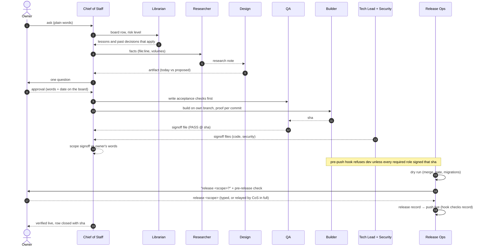
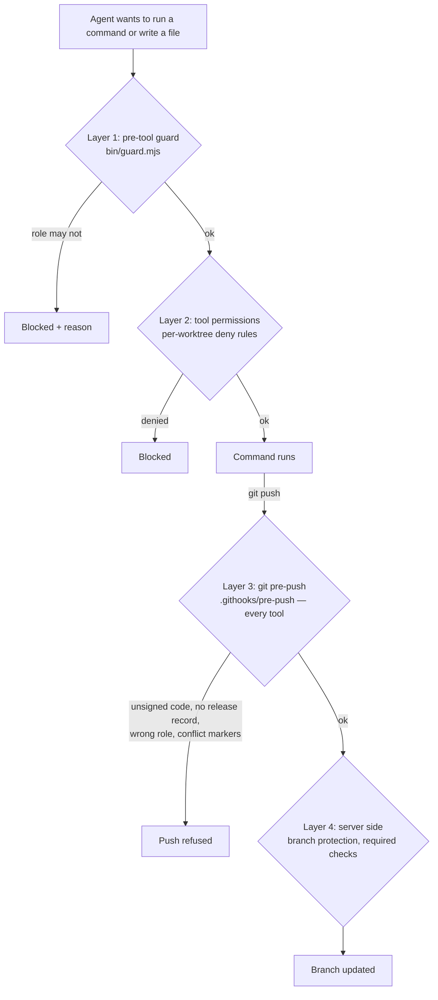

# Bootstrap-environment

**Set up any software project for AI coding agents, then run it like a small IT company.** One
coordinating session (the Chief of Staff) runs named role sessions — Librarian, Researcher, Design,
Builder, QA, Tech Lead, Security, Release Ops, Hotfix, plus on-demand Platform and Support — and their
limits are **enforced by tooling**, not just written down.

It ships as an [Agent Skill](https://agentskills.io) plus a dependency-free Node toolkit, packaged as a
Claude Code plugin, with adapters for Cursor, Codex, GitHub Copilot, Antigravity, Devin Desktop, Kiro,
OpenCode, Cline, Aider, Zed, Junie, Amp and ChatGPT.

> Status: **0.1.0, early.** The enforcement scripts have a test suite (23 tests, real temporary git repos). The per-tool adapters follow vendor docs as of November 2026 and are not yet tested inside each tool — see [TODO.md](TODO.md).

## What it does

1. **Bootstrap (once per project).** Probe runtimes by running them; detect the stack from lockfiles;
   install dependencies exactly as locked; search the official marketplace, the marketplaces you have and
   GitHub for the best free plugin per need (language server, framework, browser driver, security);
   smoke-test every one; scaffold `AGENTS.md`, a board, a pending register, sign-off and release records
   and a conflict-free memory.
2. **Session family (every day).** The owner talks to one session. Work moves through a fixed lane with
   sign-offs. Nothing reaches the shared branch until the right roles have signed the exact commit, and
   nothing reaches live without the owner's word recorded with its question, scope and a pasted check.

## How information flows


Chat is a copy; the repository is the record. Every session writes its own log and its own sign-off
files (one writer per file, so no merge conflicts), and the Chief of Staff relays nothing that is not
written down.

## How a piece of work moves



## How the rules are enforced (defence in depth)



| Layer | Where | Catches | Works in |
|---|---|---|---|
| 1 Guard | pre-tool hook | force-push, `--no-verify`, hook tampering, server commands, live push by the wrong role, docs-only roles writing code, protected config | Claude Code (plugin or project hook); other tools where hooks exist — see adapters |
| 2 Permissions | `.claude/settings.local.json` per worktree (`bootstrap role`) | the role's `deny` list; plugin kit narrowing | Claude Code; partial elsewhere |
| 3 Pre-push | `git config core.hooksPath .githooks` | code commits without complete sign-offs on that sha; live pushes without a release record (owner's words, question, shas, pasted check); deleting live/dev; conflict markers | **every tool and every human** |
| 4 Server | GitHub branch protection / required checks | anything pushed from a machine without the hooks, including cloud agents | GitHub (configure it — see TODO) |

Layers 1–3 run on the developer's machine and can be bypassed by someone determined to; layer 4 cannot.
Turn it on for the live and dev branches.

## The roles

| Role id | Job | Never | Class |
|---|---|---|---|
| `chief-of-staff` | owner's single contact; rows, risk, briefs, scope sign-off, relays, daily digest | push live, decide for the owner | core · strongest model |
| `librarian` | lessons, decisions trail, board and register hygiene | code, decisions | core · cheapest |
| `researcher` | facts with file:line, volumes, options | app code, real-DB writes | core |
| `design` | artifacts today-vs-proposed; signs built screens | code | core |
| `builder` | builds on its own branch with proof | push before sign-offs, touch live | core |
| `qa` | acceptance checks before code; tests on a copy | fix app code | core |
| `tech-lead` | ADRs, code and schema review, dependency upgrades | review its own code | core · strong |
| `security` | reviews sensitive surfaces, audits, plugin trust checks | sign its own fixes | core |
| `release-ops` | dry run, batches, push live on the recorded word | hotfixes, relayed peer words | core |
| `hotfix` | live breakage only, cloud, pushes on "apply" | features, running locally | core · cloud |
| `platform` | CI, environments, DB server, backups, monitoring | run server commands itself | on demand |
| `support` | user reports → rows, release notes | promise users dates | on demand |
| `project-lane` | one cross-cutting area (template) | another lane's files | per project |

Each role's brief — job, never, kit, first message — is a file in [`roles/`](roles). The Chief of Staff
sends it unchanged; the guard and adapters read the same file.

## Install

**Claude Code** (full support):

```bash
claude plugin marketplace add AnfalHaider/Bootstrap-environment
```

```bash
claude plugin install bootstrap-environment@bootstrap-environment --scope project
```

Then ask: *"bootstrap this project"*. The skill runs the phases and calls the toolkit.

**Any tool with a shell** (clone once, run inside your project):

```bash
git clone https://github.com/AnfalHaider/Bootstrap-environment ~/bootstrap-environment
```

```bash
node ~/bootstrap-environment/bin/detect-stack.mjs
```

```bash
node ~/bootstrap-environment/bin/bootstrap.mjs init --live main --dev dev
```

```bash
node .bootstrap/bin/adapt.mjs cursor
```

Replace `cursor` with your tool: `node .bootstrap/bin/adapt.mjs list` shows them all and what each gets.

## Tool support at a glance

| Tool | Skill | Role agents | Guard hook | Pre-push | Notes |
|---|---|---|---|---|---|
| Claude Code | yes | session family | yes | yes | baseline; plugin + marketplace in this repo |
| Cursor | yes | `.cursor/agents` | manual wiring | yes | subagents only have `readonly` |
| Codex | yes | separate launches | `.codex/rules` | yes | no LSP; AGENTS.md ≤ 32 KiB |
| GitHub Copilot | yes | `.github/agents` | manual wiring | yes | cloud agent: MCP tools only |
| Antigravity CLI | yes | `.agents/agents` | manual wiring | yes | replaces Gemini CLI for free users |
| Devin Desktop | yes | — | project hook | yes | ex-Windsurf; installs the Claude plugin |
| Kiro | yes | `.kiro/agents` | manual wiring | yes | steering file always included |
| OpenCode | yes | `opencode.json` agents | — | yes | per-agent permissions |
| Cline | yes | single agent | — | yes | hooks don't run on Windows |
| Aider · Zed · Junie · Amp | partial | — | — | yes | AGENTS.md + git hooks |
| ChatGPT | upload | advisor only | — | — | no filesystem: Chief of Staff/Librarian as advisors, work goes to Codex |

Details, sources and what degrades: [docs/compatibility.md](docs/compatibility.md).

## Repository layout

```
skills/bootstrap-environment/   SKILL.md (Agent Skills format) + references/ opened per phase
bin/                            guard, prepush, bootstrap, mem, detect-stack, adapt (Node ≥18, no deps)
roles/                          one brief per role — the single source for sessions and adapters
templates/                      AGENTS.md, CLAUDE.md, board, register, memory, lesson template
githooks/pre-push               installed into projects as .githooks/pre-push
hooks/hooks.json                Claude Code plugin hook → bin/guard.mjs
.claude-plugin/                 Claude Code plugin + marketplace manifests
plugin.json                     Agent Plugins layout manifest
docs/                           compatibility matrix, playbook (HTML)
tests/                          node --test tests/enforcement.test.mjs
```

## Principles

Every rule carries the failure that produced it, because a rule without its reason gets argued away. Those
failures came from running agent families on a live business application. A few examples:

- A guard hook crashed on load and silently allowed everything, so every hook branch is executed before it is enabled.
- Two sessions tested the wrong code through a linked dependency folder, so every worktree gets real dependency folders.
- A relayed "yes" was broader than the question it answered, so relays carry the question exactly as it was asked.
- A gate that never loaded pages per role passed a 500 error on every phone page, so the gate loads every page as every role.

## Contributing

Issues and pull requests are welcome, especially adapter fixes from people who use those tools daily.
Run `npm test` before opening a PR; new enforcement needs a test for every branch.

## Licence

[MIT](LICENSE)
